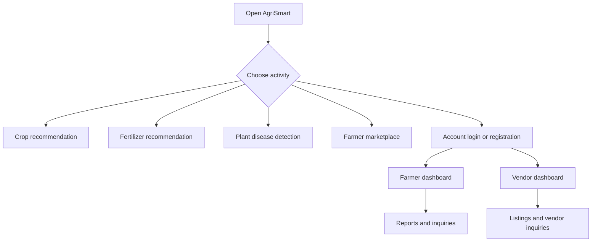
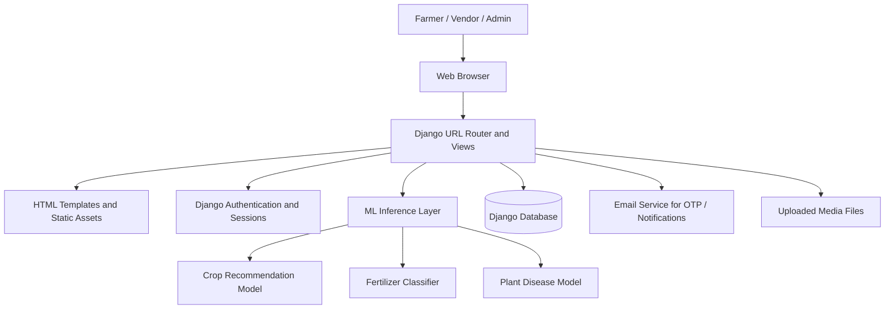
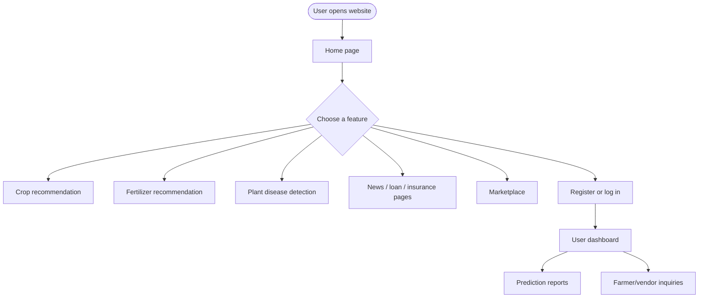
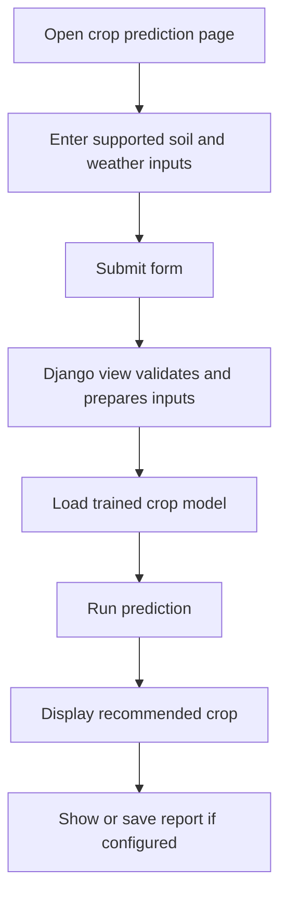
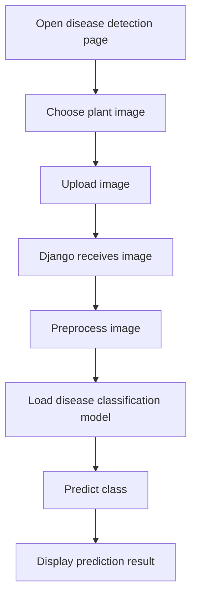
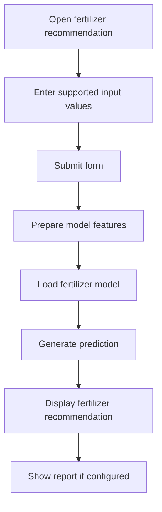
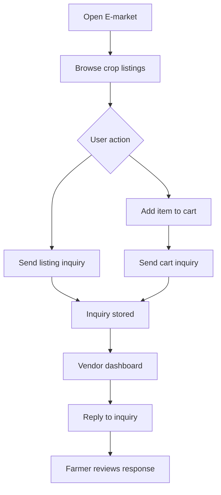

# AgriSmart — Crop Prediction and Smart Farming Web Application

<p align="center">
  <strong>A Django-based agricultural web application for crop recommendation, fertilizer guidance, plant-disease prediction, farmer services, and a crop marketplace.</strong>
</p>

<p align="center">
  <a href="https://thezohaibkhan.github.io/Crop-Prediction/">🌐 Live Demo</a> ·
  <a href="https://github.com/TheZohaibKhan/Crop-Prediction">📦 Source Repository</a> ·
  <a href="#features">✨ Features</a> ·
  <a href="#local-installation">⚙️ Run Locally</a>
</p>

> **Live demo status:** The source repository contains a Django web application with templates and backend views. A working public deployment URL was not included with the project files, so the Live Demo link below must be updated after deploying the Django application to a hosting provider. GitHub Pages cannot run Django/Python backend code.

---

## Table of Contents

- [1. Project Overview](#1-project-overview)
- [2. Problem Statement](#2-problem-statement)
- [3. Objectives](#3-objectives)
- [4. Features](#4-features)
- [5. User Roles](#5-user-roles)
- [6. Technology Stack](#6-technology-stack)
- [7. System Architecture](#7-system-architecture)
- [8. Application Workflow](#8-application-workflow)
- [9. Crop Recommendation Workflow](#9-crop-recommendation-workflow)
- [10. Plant Disease Detection Workflow](#10-plant-disease-detection-workflow)
- [11. Fertilizer Recommendation Workflow](#11-fertilizer-recommendation-workflow)
- [12. Farmer Marketplace Workflow](#12-farmer-marketplace-workflow)
- [13. Machine Learning Assets and Datasets](#13-machine-learning-assets-and-datasets)
- [14. Repository Structure](#14-repository-structure)
- [15. Prerequisites](#15-prerequisites)
- [16. Local Installation](#16-local-installation)
- [17. Database Setup](#17-database-setup)
- [18. Run the Application](#18-run-the-application)
- [19. Deployment and Live Demo](#19-deployment-and-live-demo)
- [20. Environment Variables and Secrets](#20-environment-variables-and-secrets)
- [21. Testing Checklist](#21-testing-checklist)
- [22. Troubleshooting](#22-troubleshooting)
- [23. Security and Privacy](#23-security-and-privacy)
- [24. Limitations](#24-limitations)
- [25. Future Enhancements](#25-future-enhancements)
- [26. Contributing](#26-contributing)
- [27. License](#27-license)
- [28. References](#28-references)

---

## Live Demo

**Live application:** `Not deployed yet — add the public deployment URL here after hosting the Django application.`

**Source code:** [TheZohaibKhan/Crop-Prediction](https://github.com/TheZohaibKhan/Crop-Prediction)

The project uses Django views, templates, a database, and machine-learning libraries. A GitHub repository URL is a source-code link, not a running website. GitHub Pages serves static files and cannot run this Django backend. Deploy the app to a Python-capable host, configure its database, model files, static/media files, and secrets, then replace the Live Demo placeholder with the exact URL provided by the hosting service.

---

## 1. Project Overview

AgriSmart is an agricultural web application designed to bring crop-related machine-learning predictions and farmer-oriented services into one web interface. The repository includes a Django project, HTML templates, static assets, agricultural datasets, and trained model files.

The application includes workflows for crop recommendation, fertilizer recommendation, plant-disease image analysis, farmer reports, crop-related information, account management, and a marketplace where users and vendors can interact with crop listings and inquiries.

The project is intended for learning, demonstration, and further development. Predictions are model outputs and should be considered advisory; they are not a replacement for local agronomic expertise, laboratory soil testing, or official agricultural guidance.

## 2. Problem Statement

Farmers may need to make decisions about crop selection, nutrient application, plant-disease identification, market access, and agricultural services. Relevant information can be spread across different tools and sources.

This project explores a single web application that can:

- Accept soil and environmental inputs for crop-related recommendations.
- Use trained machine-learning models for supported prediction tasks.
- Provide fertilizer guidance based on supported inputs.
- Accept plant images for disease-classification workflows.
- Present reports and farmer-facing pages.
- Support farmer/vendor accounts, listings, and inquiries.

The quality of any recommendation depends on the dataset, model training, input quality, and deployment configuration.

## 3. Objectives

1. Develop a web interface for agricultural prediction and farmer services.
2. Connect Django views to trained machine-learning models.
3. Provide crop recommendation and fertilizer recommendation workflows.
4. Provide an image-upload workflow for plant-disease prediction.
5. Maintain application users and relevant prediction/report data using Django models.
6. Provide farmer and vendor account flows and marketplace interactions.
7. Document local setup, database configuration, deployment, and security requirements.

---

## 4. Features

The uploaded source includes routes and templates for the following areas. Exact availability in a live environment depends on correct dependency installation, model files, database migrations, email configuration, and testing.

| Feature / module | Purpose |
|---|---|
| Home page | Main application entry point (`templates/index.html`) |
| User registration and login | Farmer/user account workflows |
| Dashboard | Authenticated user dashboard and inquiry overview |
| Crop recommendation | Input-based crop prediction workflow |
| Crop reports | Views for displaying crop prediction/report information |
| Fertilizer recommendation | Fertilizer-related prediction workflow |
| Plant-disease detection | Image upload and image-model inference |
| News and search | Agricultural news pages and search workflow |
| Loan and insurance information | Pages for agriculture-related financial information |
| E-market | Crop listing and marketplace interface |
| Vendor registration and login | Vendor account workflow |
| Vendor dashboard | Vendor listing and inquiry management |
| Listing and cart actions | Marketplace listing and cart-related views |
| Farmer/vendor inquiries | Send, view, reply to, and delete inquiry workflows |
| Profile editing | User profile update workflow |
| Password reset | Email OTP-related password reset views |
| Reports | Crop/fertilizer report pages |
| Admin interface | Django admin, subject to configuration |

---

## 5. User Roles

### Farmer / General User

The user-facing application includes registration, login, dashboard, crop/fertilizer prediction pages, reports, profile editing, marketplace browsing, and inquiry workflows.

### Vendor

The vendor flow includes registration, login, a vendor dashboard, profile editing, listing management, and communication with farmers through inquiries.

### Administrator

Django's administrative interface can be used to manage registered models and records when an authorized staff account has been configured.

### Role workflow



---

## 6. Technology Stack

| Technology | Purpose |
|---|---|
| Python | Backend language and model integration |
| Django | Web framework, routing, templates, authentication, ORM |
| HTML / CSS / JavaScript | Web application interface |
| SQLite | Database configured in the supplied Django settings |
| TensorFlow / Keras | Deep-learning model loading and inference |
| NumPy | Numerical operations |
| Pickle | Loading serialized ML estimators |
| Pandas / CSV | Dataset handling where used |
| Pillow / image utilities | Image processing where used |
| Jupyter Notebook | Model experimentation and training assets |
| Git / GitHub | Version control and source repository |

Confirm exact dependency versions from a `requirements.txt` file. The uploaded project archive did not include a root `requirements.txt`, so one should be created and tested before deploying.

---

## 7. System Architecture

The application can be viewed as four connected layers:

1. **Presentation layer:** Django templates and static assets render the web pages.
2. **Application layer:** Django URL patterns and views handle requests, validation, authentication, reports, marketplace actions, and prediction requests.
3. **Machine-learning layer:** Serialized models and TensorFlow/Keras models produce predictions for supported tasks.
4. **Data layer:** Django models and the configured database store account-related and application records; CSV files and model assets support prediction workflows.

### Architecture diagram



### Architecture notes

- Django is the server-side application; this is not a static-only website.
- Model files must be present at the paths expected by the application.
- Database migrations must be applied before using database-backed pages.
- Email-related workflows require valid, securely configured email credentials.
- The deployed host must support the Python and ML-library versions used by the project.

---

## 8. Application Workflow



---

## 9. Crop Recommendation Workflow

The repository includes a crop recommendation dataset and serialized model asset. The application exposes a crop prediction route and associated templates.



Typical agricultural inputs for crop recommendation models can include soil nutrients and environmental variables. Use the exact input fields and order implemented by the application and model; do not assume that every model accepts the same features.

---

## 10. Plant Disease Detection Workflow

The source contains a `Leaf_disease/` image folder, image-related templates/views, and Keras/TensorFlow model assets. The application includes an image-upload/prediction workflow.



Image quality, model preprocessing, class order, and the training dataset all affect results. A model prediction should not be treated as a definitive diagnosis or as a substitute for advice from an agricultural specialist.

---

## 11. Fertilizer Recommendation Workflow

The project contains a fertilizer prediction dataset and serialized classifier assets.



Use recommendations as decision support only. Fertilizer choice and dosage should account for crop variety, soil test results, local conditions, and official agricultural guidance.

---

## 12. Farmer Marketplace Workflow

The source includes vendor and farmer workflows, listing records, a cart-related flow, and inquiry/reply views.



The exact permissions and validation should be verified in the corresponding Django views and model definitions before public deployment.

---

## 13. Machine Learning Assets and Datasets

The uploaded project archive includes a `dataset/` directory with files such as:

- `Crop_recommendation.csv`
- `Fertilizer Prediction.csv`
- `crop_prediction.pkl`
- `Fertilizer_Classifier.pkl`
- `NBClassifier.pkl`
- `best_model.h5`
- `model_sev.h5`
- Several Jupyter notebooks for training and experimentation

The repository also contains image examples under `Leaf_disease/` and a directory of interface screenshots.

### Model asset notes

- `.pkl` files are serialized Python objects; load only trusted files.
- `.h5` files can contain Keras/TensorFlow model weights or model structures.
- Model input shape, preprocessing, class labels, and library versions must match the code that loads each model.
- Training notebooks are included for exploration; their presence does not establish a measured production accuracy.
- Check the repository's model-loading code before renaming or moving any dataset/model file.

---

## 14. Repository Structure

The following structure is based on the uploaded project archive. Some generated files and optional assets may be omitted from this overview.

```text
Crop-Prediction/
├── manage.py
├── .gitignore
├── crop_prediction/
│   ├── settings.py
│   ├── urls.py
│   ├── asgi.py
│   └── wsgi.py
├── app/
│   ├── models.py
│   ├── views.py
│   ├── urls.py
│   ├── auth.py
│   ├── admin.py
│   └── migrations/
├── templates/
│   ├── index.html
│   ├── base.html
│   ├── crop_prediction.html
│   ├── fert_rec.html
│   ├── dashboard.html
│   ├── e_market.html
│   ├── vendor_dashboard.html
│   └── ...other application templates
├── static/
├── dataset/
│   ├── Crop_recommendation.csv
│   ├── Fertilizer Prediction.csv
│   ├── crop_prediction.pkl
│   ├── Fertilizer_Classifier.pkl
│   ├── NBClassifier.pkl
│   ├── best_model.h5
│   ├── model_sev.h5
│   └── ...training notebooks and datasets
├── Leaf_disease/
├── Output And Interface ScreenShots/
└── README.md
```

---

## 15. Prerequisites

Install:

- Python compatible with the project's Django and TensorFlow/Keras dependencies
- pip
- Git
- A virtual environment tool (`venv` is included with Python)
- Enough disk space and memory to load the ML models

Check Python and pip:

```bash
python --version
python -m pip --version
```

Because the archive does not include a root `requirements.txt`, dependency versions need to be identified from imports and the environment used during development before deployment.

---

## 16. Local Installation

### Step 1 — Clone the repository

```bash
git clone https://github.com/TheZohaibKhan/Crop-Prediction.git
cd Crop-Prediction
```

### Step 2 — Create a virtual environment

Windows:

```bash
python -m venv .venv
.venv\Scripts\activate
```

macOS / Linux:

```bash
python3 -m venv .venv
source .venv/bin/activate
```

### Step 3 — Install dependencies

First create and test a `requirements.txt` containing the packages and compatible versions actually used by the project. Then install them:

```bash
python -m pip install --upgrade pip
pip install -r requirements.txt
```

Do not blindly install the newest TensorFlow/Keras versions without checking compatibility with the serialized models and the Python version.

### Step 4 — Configure environment variables

Move secret configuration out of `crop_prediction/settings.py`. At minimum, configure a new Django `SECRET_KEY`, `DEBUG`, `ALLOWED_HOSTS`, database settings, and email credentials using environment variables or the host's secret manager. See [Environment Variables and Secrets](#20-environment-variables-and-secrets).

### Step 5 — Apply migrations

```bash
python manage.py migrate
```

### Step 6 — Create an admin account

```bash
python manage.py createsuperuser
```

Follow the prompts to create a local administrator account.

---

## 17. Database Setup

The supplied Django settings configure SQLite by default:

```python
DATABASES = {
    "default": {
        "ENGINE": "django.db.backends.sqlite3",
        "NAME": BASE_DIR / "db.sqlite3",
    }
}
```

For local development, SQLite is convenient. For a public deployment, choose a database supported by the hosting platform and configure it through environment variables. Run migrations after configuring the database:

```bash
python manage.py makemigrations
python manage.py migrate
```

Only create new migrations when model changes require them. Existing migrations are included in the `app/migrations/` directory.

Do not commit a production database file or user-uploaded media to GitHub.

---

## 18. Run the Application

Start the local Django development server:

```bash
python manage.py runserver
```

Open:

```text
http://127.0.0.1:8000/
```

Other application paths are defined in `crop_prediction/urls.py` and `app/urls.py`. Use the URL patterns in those files as the source of truth.

### Basic smoke test

- Open the homepage.
- Test registration and login with dummy details.
- Open crop and fertilizer prediction pages.
- Test image upload using a sample image.
- Test dashboard and report pages after logging in.
- Test marketplace/vendor flows with test accounts.
- Review the terminal and browser console if an error occurs.

---

## 19. Deployment and Live Demo

### Important: GitHub Pages is not suitable for this Django app

The project uses Django views, Python model inference, database models, and server-side templates. GitHub Pages can host static HTML/CSS/JavaScript, but it cannot run Django, Python, TensorFlow, database migrations, or server-side authentication.

To publish a working live web application, deploy the Django project to a Python-capable hosting service.

### Deployment checklist

1. Create and verify `requirements.txt`.
2. Move all credentials and Django settings secrets to environment variables.
3. Set `DEBUG=False` in production.
4. Configure `ALLOWED_HOSTS` for the deployed domain.
5. Configure the production database and run migrations.
6. Configure static files with Django's static-file collection and the chosen hosting provider.
7. Configure media storage for user-uploaded images.
8. Ensure model files are present and load correctly within the host's memory and storage limits.
9. Configure email credentials if OTP/password reset requires email.
10. Start the app using the host's supported WSGI/ASGI command.
11. Test authentication, predictions, uploads, reports, and marketplace interactions.
12. Replace the Live Demo placeholder at the top of this README with the actual deployed URL.

### Typical production commands

After the deployment environment is configured, Django deployments commonly require:

```bash
python manage.py check --deploy
python manage.py migrate
python manage.py collectstatic --noinput
```

Use the exact start command and static/media configuration required by the selected host. These commands alone do not deploy the application.

### Live Demo link

Once deployment is complete, update the top section to use the real URL, for example:

```markdown
[🌐 Live Demo](https://your-actual-deployed-domain.example)
```

Replace the example with the URL provided by your hosting dashboard. Do not use a guessed URL or a GitHub repository URL as the live application URL.

---

## 20. Environment Variables and Secrets

**Security action required before public deployment:** The supplied archive's Django settings file contains hard-coded secret configuration, including a Django secret key and email SMTP credentials. Treat these values as exposed. Rotate/revoke the email credential immediately, generate a new Django secret key, and remove secrets from the source code and repository history as appropriate. Do not reuse the exposed values.

Recommended configuration includes:

- `DJANGO_SECRET_KEY`
- `DJANGO_DEBUG`
- `DJANGO_ALLOWED_HOSTS`
- Database connection variables appropriate to the chosen host
- SMTP host, port, username, and password variables if email is enabled

Example `.env` file for local development only:

```dotenv
DJANGO_SECRET_KEY=replace-with-a-new-random-secret
DJANGO_DEBUG=True
DJANGO_ALLOWED_HOSTS=127.0.0.1,localhost
EMAIL_HOST=smtp.example.com
EMAIL_PORT=587
EMAIL_USE_TLS=True
EMAIL_HOST_USER=your-email@example.com
EMAIL_HOST_PASSWORD=replace-with-a-new-app-password
```

This is an example only. The application must be updated to read these values from the environment, and `.env` must be excluded from Git. Never place real secrets in README files, frontend code, screenshots, or public commits.

If a credential has been committed, changing the current file is not enough by itself: revoke or rotate the credential and consider cleaning the repository history.

---

## 21. Testing Checklist

- [ ] Django system checks complete without errors.
- [ ] Database migrations apply successfully.
- [ ] Admin account can log in.
- [ ] Registration and login work with test accounts.
- [ ] Crop recommendation page accepts valid inputs.
- [ ] Model files load and return the expected output format.
- [ ] Fertilizer recommendation page works with supported inputs.
- [ ] Disease-image upload and prediction work.
- [ ] Dashboard and reports show the expected data.
- [ ] Marketplace listing and inquiry flows work.
- [ ] Password reset/email configuration is tested if enabled.
- [ ] Static files load in production.
- [ ] Media uploads use the intended storage configuration.
- [ ] `DEBUG=False` and `ALLOWED_HOSTS` are configured for production.
- [ ] No credentials, production database, or sensitive user data are committed.
- [ ] The public Live Demo URL opens the deployed application.

Useful commands:

```bash
python manage.py check
python manage.py test
python manage.py check --deploy
```

The deployment check may report configuration warnings until production settings are configured.

---

## 22. Troubleshooting

### `ModuleNotFoundError`

Activate the correct virtual environment and install dependencies from the tested `requirements.txt`. Confirm that the Python version matches the installed ML libraries.

### TensorFlow/Keras model fails to load

- Check TensorFlow/Keras compatibility with the model file.
- Confirm the model path and file name match the code.
- Check required custom layers/functions, preprocessing steps, and input dimensions.
- Ensure sufficient memory is available.

### `OperationalError: no such table`

Run:

```bash
python manage.py migrate
```

### Static files do not load in production

Configure Django static-file settings and the selected host's static serving/storage process. Run:

```bash
python manage.py collectstatic --noinput
```

### Uploaded images are missing

Configure `MEDIA_ROOT`, `MEDIA_URL`, and production media storage. Local development media handling is not automatically suitable for production hosting.

### Email OTP or password reset fails

- Verify the SMTP host and port.
- Check the email provider's current authentication requirements.
- Rotate any exposed email credentials.
- Configure credentials through environment variables.
- Check application logs without printing passwords or OTPs.

### Website works locally but fails after deployment

Check the deployed Python version, installed packages, environment variables, database migrations, `ALLOWED_HOSTS`, static/media configuration, and whether the model assets fit the host's memory and storage limits.

### Need a direct live link

Deploy the Django application to a Python-capable host first. The GitHub repository link opens the source code; GitHub Pages cannot run the Django backend.

---

## 23. Security and Privacy

- Do not commit Django secret keys, email passwords/app passwords, API keys, or other credentials.
- Rotate any secret that has already been exposed in the repository or uploaded archive.
- Set `DEBUG=False` in production.
- Restrict `ALLOWED_HOSTS` to the correct hostnames.
- Use HTTPS for the deployed application.
- Use secure cookie/session settings appropriate for production.
- Validate uploaded files, file types, file sizes, and image-processing inputs.
- Store uploaded files using an appropriate media-storage service.
- Use proper authentication and authorization checks for user/vendor records.
- Avoid exposing sensitive user data in logs or reports.
- Treat ML predictions as advisory and communicate model limitations.
- Back up production data securely and restrict database access.

---

## 24. Limitations

- Prediction quality depends on training data, feature preprocessing, model versions, and real-world conditions.
- A trained model file does not prove a particular accuracy unless it is evaluated on a suitable independent dataset.
- The archive does not include a root `requirements.txt`; dependencies must be identified and pinned before reproducible setup or deployment.
- SQLite is configured by default and may not be suitable for a multi-user production deployment.
- Email workflows require properly configured SMTP credentials.
- Uploaded media requires an intentional storage and retention strategy.
- GitHub Pages cannot run the Django backend.
- Public deployment requires production settings, security checks, database setup, and model compatibility testing.

---

## 25. Future Enhancements

- Add a pinned `requirements.txt` and reproducible environment setup.
- Separate development and production Django settings.
- Move secrets to environment variables and rotate exposed credentials.
- Add automated tests for prediction views, account flows, uploads, and marketplace interactions.
- Evaluate ML models on held-out data and document appropriate metrics.
- Add clearer prediction explanations and input validation.
- Improve responsive design and accessibility.
- Add secure media storage and retention controls.
- Add structured logging and production error monitoring.
- Deploy the Django application to a Python-capable host and publish a verified Live Demo link.
- Add CI checks for Django tests, dependency vulnerabilities, and deployment configuration.

---

## 26. Contributing

Contributions to code, documentation, tests, accessibility, and model evaluation are welcome.

1. Fork the repository.
2. Create a feature branch.
3. Make a focused change.
4. Run relevant Django checks and tests.
5. Open a pull request explaining the change and how it was tested.

Do not include private user data, credentials, uploaded private files, or untrusted serialized model assets.

---

## 27. License

No explicit license was verified in the supplied project archive. Unless a license is added to the repository, do not assume that others have permission to reuse, redistribute, or modify the project. Add a suitable `LICENSE` file if you intend to publish it as open source.

---

## 28. References

- [Python](https://www.python.org/)
- [Django Documentation](https://docs.djangoproject.com/)
- [TensorFlow](https://www.tensorflow.org/)
- [Keras](https://keras.io/)
- [NumPy](https://numpy.org/)
- [Pandas](https://pandas.pydata.org/)
- [GitHub Actions](https://docs.github.com/en/actions)
- [GitHub Pages](https://docs.github.com/en/pages)

---

<p align="center">
  <strong>AgriSmart — Smarter Decisions for Agriculture</strong><br>
  <sub>Academic project documentation · Deploy and validate the Django application before sharing a public demo.</sub>
</p>
